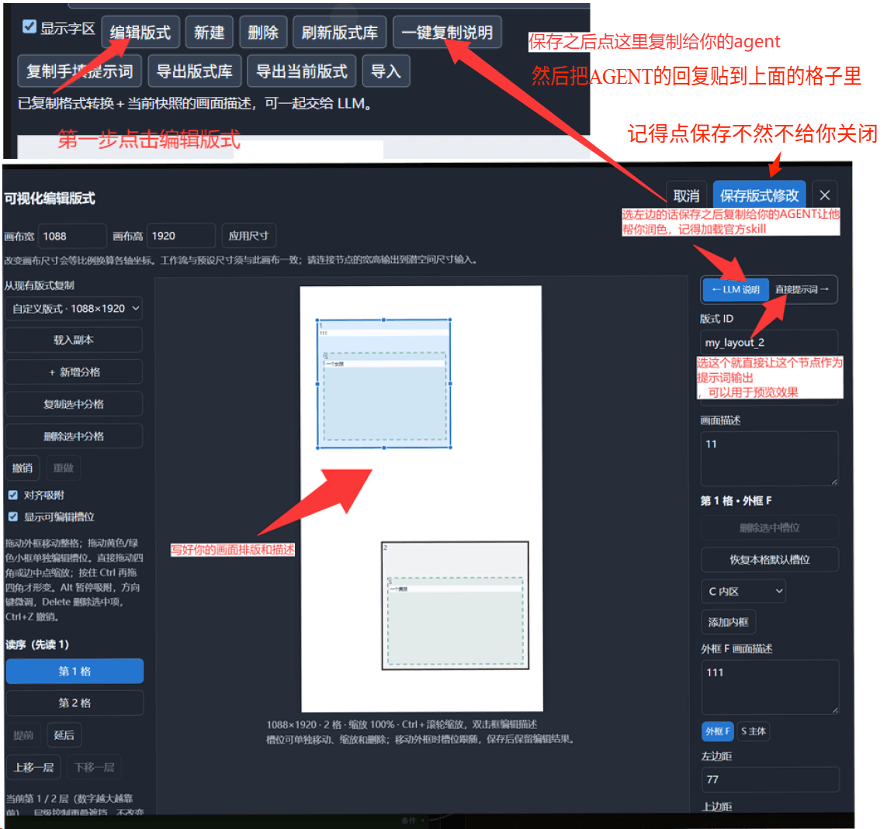

# MOSS 漫画版式控制

先点击「编辑版式」填写各框的画面描述并保存。选择「LLM 说明」时，一键复制说明交给 agent，再将回复粘贴到节点输入框；选择「直接提示词」时，节点直接编译手填内容。



独立 ComfyUI 节点。输入框支持普通画面提示词和单页 MOSS Layout JSON，也支持在编辑器填写画面与台词后直接输出提示词。节点使用本地编译，不请求大模型 API。

## 使用

1. 在 `ComfyUI/custom_nodes/` 中运行以下命令，然后重启 ComfyUI 并刷新浏览器。无需额外 pip 依赖。

   ```text
   git clone https://github.com/wuhehen176/ComfyUI-MOSS-MangaLayout.git
   ```
2. 添加 **MOSS-Image/漫画 → MOSS 漫画版式控制**，从“版式库”选择版式，两种模式共用同一个库。编辑器保存后立即加入库中并选中，无需刷新。下方预览显示外框、格号及字区，面板高度随按钮换行和提示文字调整；这些预览标记不会成为图中文字。
3. 在编辑器右侧顶部左右切换 **LLM 说明／直接提示词**。整页和各框的“画面描述”共用，切换不改变描述。LLM 模式点“一键复制说明”交给外部 LLM，再把 JSON 粘贴到 `layout_json`；直接模式将描述直接编译，另可追加人物和准确台词。
4. `layout_prompt` 接 MOSS 工作流的 **CLIP 文本编码器**的 `text`；`width`、`height` 接潜空间节点对应尺寸。通过右键菜单将尺寸控件转成输入接口。
5. 按原 MOSS 工作流采样。Layout JSON 输出的 `bbox_coord_space` 为 `abs_centralized`，`bbox_format` 为 `yxyx`；普通文本输出布局说明与原画面描述。

单独运行本节点也可以检查编译结果，无需模型。它输出 `STRING / INT / INT`，没有 IMAGE 接口。

直接提示词模式读取当前快照里保存的手填内容，`layout_json` 中的 LLM 输入继续保留，切回 LLM 模式后使用。画面描述按填写的语言原样输出，建议英文；对白填中文、拟声填日文。文字表现说明可补说话人、气泡和位置；中文文字自动标注逐字保留，字号按每项字数选择。空白条目保留为草稿，已写文字表现说明时需同时填准确文字；同一框内的多条文字沿列表顺序排列，跨字区按位置阅读。节点的“复制手填提示词”直接复制已填坐标的 JSON，内容与运行节点的 `layout_prompt` 一致。

可直接导入 [单节点编译检查工作流](examples/单节点编译检查.json) 查看界面和输入结构；该示例只运行编译，不采样生图。

## 完整采样示例工作流

[MOSS 漫画.json](examples/MOSS%20漫画.json) 包含模型加载、8／50 步分支切换、LoRA Manager、版式编译、文本编码、采样及保存链。导入后需选择本机模型和 LoRA，并填写画面内容；版式节点的提示词与宽高已接好。依赖、填写位置和原始参数差异见 [工作流说明](examples/MOSS漫画工作流说明.md)。

## 参考图示例模板

- **阿罗娜·浪潮跨格前景**：[节点工作流](examples/arona/workflow.json)、[版式](examples/arona/layout.json)、[实测图](examples/arona/result.png)。四背景区域与整页跳跃人物，背景为彩色。
- **飞鸟马时·左侧分镜右侧披风跨格**：[节点工作流](examples/toki/workflow.json)、[版式](examples/toki/layout.json)、[实测图](examples/toki/result.png)。脸部、手部、雪景、回应四段镜头，右侧大人物连续跨格。

两套均已写好外框与内框用途，可作为新图的起点。直接导入对应 workflow.json，或在“导入”中选择 layout.json；同名 ID 已在库中时直接选择已有项，不会重复导入。prompt.json 是内容输入，instructions.txt 是给外部 LLM 的格式与用途说明。工作流保存完整快照，修改示例库不会覆盖旧工作流。

实测只证明各自一次结果：阿罗娜的屈膝姿态未精确复现；飞鸟马时的左下格被扩宽、披风变短。几何是提示词约束，不是像素蒙版。

## 输入约定

LLM 输入模式下，`layout_json` 自动识别两种格式：普通自然语言或标签作为整页正向描述，与所选版式的格数、读序、框坐标及层级说明一起输出；各人物、文字的精确槽位分配仍使用 Layout JSON。普通文本保留原语言与内容，本地编译不会代写剧情、翻译或拆分成 items。

以 `{`、`[` 开头的输入按结构化内容校验；也可粘贴含一个 JSON 代码块的完整 LLM 回复，节点仅提取代码块内的 JSON，改动说明不会进入生图。多个代码块、未闭合围栏或损坏的 JSON 会报错，避免选错内容。空白输入提示补充内容。直接提示词模式继续使用编辑器已保存的画面／台词，输入框保留供切回 LLM 模式使用。

Layout JSON 的字段约定如下。

根对象含 `summary.caption` 和非空 `items` 数组。每个 item 含 `panel`（从 1 起，按编辑器读序编号）、`slot`、`label`、`caption`；`label` 为 `object / character / text`，文字项另含非空 `text`。现有标签、文字等内容保留。

节点选择覆盖输入中的 `layout`。不存在的格号或槽位会报错，不删人物、不删台词、不自动改选字区。坐标由节点回填，原输入的 `bbox` 会被覆盖。允许只描述部分格子；编辑器决定页面外框数量。

同一矩形字区内多条文字按数组顺序上下分配；同一变形字区内多条文字会提示分别选区。同人身份、说话人和文字写法由输入负责，本节点不改写。

## 编辑及保存

- **编辑版式**：拖动分格或内槽位；普通拖角和边中点缩放，**Ctrl＋拖角**变形。C、S、字区等已有内框默认全部显示，也可用预览开关统一隐藏。内槽位可以单独移动、删除、确认或取消。读序“提前／延后”和遮挡“上移一层／下移一层”独立。
- **画面描述**：整页、外框 F 和各内框均可填写，两种模式共用同一份描述。LLM 模式把描述随“一键复制说明”交给外部模型；直接模式把描述编译成画面内容，准确台词另填。描述本身不会作为可见文字。
- **预览缩放**：鼠标放在画布区域，按住 Ctrl 向上滚轮放大、向下滚轮缩小，范围 25%～400%，以鼠标所在位置为锚点。缩放只改变预览，不修改画布尺寸、槽位坐标或输出。放大后可用区域滚动条查看其他位置。
- **预览与快捷编辑**：各框左上方显示描述摘要，双击外框或内框可弹出快捷编辑，确定后更新右侧字段；取消不改描述。内框确认／取消、复制、删除、缩放与撤销保留对应状态。
- **追加人物／台词**：直接模式允许同框添加多个场景、人物或文字项，列表可上下移动。删除内框同时删除对应描述和条目，撤销可恢复；纯画面内容省略对白引导。
- **画布尺寸**：输入完成后宽高自动取最近的 16 倍数，再点击“应用尺寸”等比例换算坐标。输入范围 64～8192，不再提供三组固定尺寸按钮。
- **新建**：自选画布尺寸，自行添加分格，也可以从库中复制。新增分格只带 F 外框；“添加内框”单独补槽位，“恢复本格默认槽位”补常用区域。已有版式保留原内框，所有条目均可编辑、删除。
- **重复内框**：同一格可多次添加相同类型，自动使用 `S`、`S_2`、`S_3` 或 `TL`、`TL_2` 等独立键。每个框可分别拖动、形变、填写描述／台词、删除和撤销；同类框略微错开放置。LLM 按清单完整填写编号，编号不表示读序、层级或新增人物；人物数量与身份由具体画面描述决定。重复类型本身不保证内容不会混淆，请写清各框用途并避免多个字区重叠。
- **跨格主体**：把 S 内框拖动或缩放到外框之外，保存后仍保留完整坐标。编译器自动说明这是跨越边框的连续前景主体；跨格程度由 S 的实际位置控制，整体遮挡另用层级调整。
- **统一库与单文件存储**：两种模式共用 `ComfyUI/user/default/moss_manga_layout/layouts/`（随 `--user-directory` 改变），每套版式一个 `layout-版式ID-内容摘要.json` 文件；`index.json` 记录顺序与文件名。保存先写独立文件，再原子切换索引。切换模式保存会更新同一版式，不再另存到另一库。
- **旧库迁移**：首次读取自动合并旧直接库，保留原数据文件。同 ID 同内容合并；内容不同时保留为带 `_manual` 后缀的另一条，避免覆盖。旧整页两份描述合并到共用字段，原结构化人物与台词保留。迁移只做一次，删除全部后保持空库。
- **工作流快照**：选中的完整版式随工作流保存。公共库之后修改或删除，旧工作流仍用自己的快照。要更新当前节点，在版式库下拉框重新选择对应版式。
- **刷新版式库**只更新统一库的可选列表，不改当前快照。多个页面同时修改同一个库时，较旧版本保存会被拒绝；刷新后重试。
- **一键复制说明**将内容整理要求和画面描述合并为一次复制，始终使用当前节点快照。外部 LLM 先简要说明实际改动，再输出一个可复制的 JSON 代码块。允许补齐视觉细节和整合同一人物的局部，保留既定事件、身份、人数和准确台词；槽位按需选用，不填空气泡或留白占位项。节点不连接 LLM API、不新增剧情，旧工作流的快照也不会随共享库里的新描述自动改变。已从库删除的当前快照仍会在下拉框显示其状态，保留使用能力。
- **身份、说话人与可选字段**：同人身份 tag 使用英文小写、空格及括号作品限定的可读写法；仅整理已确认的角色身份 tag，其余触发词和功能标记保留。对白 caption 用英文明确说话人，旁白和拟声分别标注类型／声源。F 可以描述人物关系，详细人物信息集中到主要主体框属于推荐；`summary.canvas` 保持可选，输入已有时保留。用户指定的坐在分格线、悬浮等特殊构图按原意组织。
- **导出当前版式**导出当前节点快照，包含共用描述、人物台词与坐标；即使公共库条目已经变化，仍导出当前节点实际使用的版本。**导出版式库**导出统一库的全部条目。两种文件都可导入；旧两种模式文件均进入统一库，同名 ID 会提示改名。恢复默认槽位只作用于当前选中分格，不恢复被删除的库条目。

非矩形和层级会以外接框、轮廓描述、遮挡关系传给 MOSS，属于提示词控制；不执行蒙版裁剪，不能保证每次严格遵循几何边界。

X 虚拟槽和出框像素控件已移除，跨格主体统一使用实际 S 或编号主体框。旧版文件若显式保存了 X，需要先在编辑器改用 S 并调整占位；已有正常版式和工作流快照保持独立。更新后重启 ComfyUI 并刷新页面，再重新复制说明。

## 开发

Python 编译与持久化仅使用标准库；运行时路由复用 ComfyUI 自带 aiohttp。前端已编译到 `web/`，普通安装无需 Node.js。

```powershell
python -m unittest discover -s tests -v
cd frontend
npm install
node check.mjs
npm run build
```

前端可设置 `MOSS_BUILD_DEPENDENCIES` 指向已有依赖项目的 `package.json`，复用本机依赖进行编译。


## 参考漫画图反推 skill（通用版）

[moss-comic-reference-layout](skills/moss-comic-reference-layout/SKILL.md) 可指导能看图的 agent，从漫画参考图生成可编辑版式、各框用途及内容提示词，也可按要求替换人物和用已有 MOSS 工作流测试。

支持 SKILL.md 的 agent 按各自方式安装整个 `skills/moss-comic-reference-layout` 文件夹；其他 agent 可读取完整文件夹后按说明执行。详见[跨电脑与跨 agent 使用说明](skills/使用说明.md)。skill 不绑定本机路径、端口、模型或工作流节点 ID；实际试跑需要使用者提供自己的环境。

本仓库包含节点源代码、已编译前端、两套普通场景示例和通用 skill。示例只需本节点即可编译；完整采样仍须使用者自己的 MOSS 工作流。验证范围见[验证记录](验证记录.md)，代码来源见[NOTICE](NOTICE.md)。
